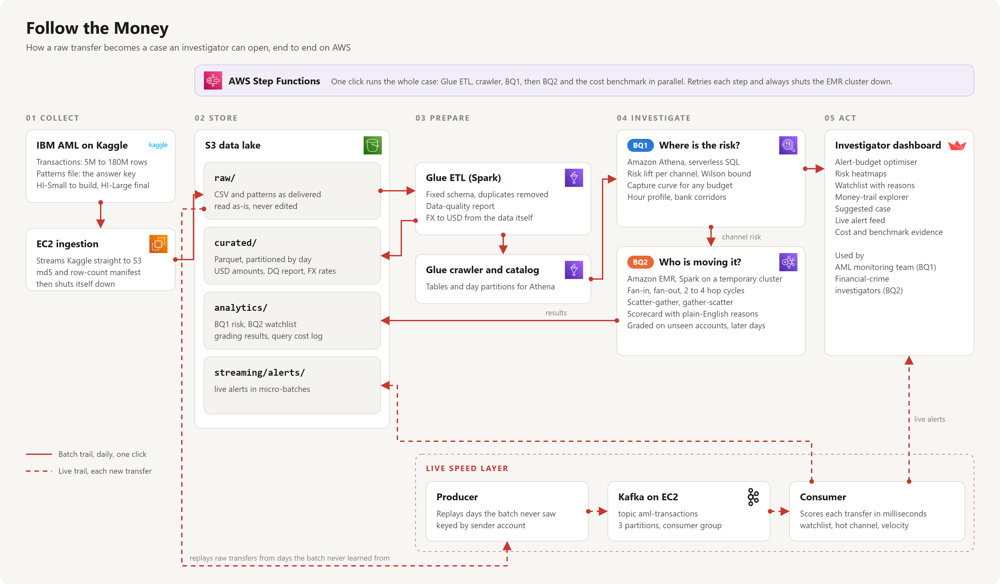

# Follow the Money  AML Risk Intelligence on AWS
**IS459 Big Data Architecture  Group G4**

An end-to-end big data pipeline on the IBM Transactions for Anti-Money-Laundering dataset (Kaggle,
[Altman et al., NeurIPS 2023](https://arxiv.org/abs/2306.16424)) that answers two business questions:

| | Business question | Who benefits | Output |
|---|---|---|---|
| **BQ1** | Where should the AML monitoring team spend its limited review capacity? | Transaction-monitoring analysts, Head of AML Compliance | Segment risk (lift + Wilson lower bound), capture curve, **alert-budget optimiser** (lists every segment to monitor at the chosen budget, with the count), heatmaps by format × currency, day × hour and bank route |
| **BQ2** | Which accounts form laundering networks, and why? | Financial-crime investigators | Graph motifs (fan-in/out, 2–4-hop cycles, scatter-gather, gather-scatter), **explainable weight-of-evidence scorecard**, top-1,000 watchlist with reasons, money-trail explorer |



## Repository map

| Path | What it is | Runs on |
|---|---|---|
| `infra/launch_ingestion_ec2.sh` → `ingestion/download_to_s3.sh` | Starts a throw-away EC2 that streams Kaggle → S3 raw zone with an md5/row-count manifest and a log, then terminates itself | EC2 |
| `glue/etl_transactions.py` (+ `patterns_parser.py`) | Raw CSV → curated Parquet: explicit schema, DQ report, implied FX → USD, features | AWS Glue (Spark) |
| `athena/q1_*.sql`, `athena/ddl.sql`, `athena/run_athena.py` | BQ1 analytics (UNLOAD to Parquet), table DDL with partition projection, CSV-vs-Parquet benchmark, per-query cost log | Athena via Glue Python shell |
| `emr/network_sql.py`, `emr/network_risk.py` | BQ2 graph motifs + scorecard + time-based evaluation, written as portable SQL steps; heavy steps checkpointed | Spark on a transient EMR cluster |
| `stepfunctions/aml_pipeline.asl.json` | Orchestration: ETL → crawler → BQ1 → (BQ2 ∥ benchmark); auto-terminates EMR on failure | Step Functions |
| `streaming/` | Kafka producer, consumer, scoring rules (`monitor_core.py`), `run_live_demo.sh` | EC2 |
| `dashboard/app.py`, `infra/launch_serving_ec2.sh` | Streamlit dashboard (Athena mode or local mode) and the serving EC2 that runs it next to Kafka | EC2 / laptop |
| `infra/create_roles.sh`, `infra/setup.sh`, `infra/teardown.sh` | Pipeline IAM role (normal accounts only), one-shot deploy (idempotent), full clean-up | CloudShell |
| `local/` | Synthetic data generator in the exact Kaggle format + local runners (SQLite) | laptop |
| `tests/test_pipeline.py` | End-to-end local test suite (10 tests) | laptop |
| `docs/` | `decisions.md` (every decision made while running on AWS, with evidence), design rationale, rubric checklist, demo + video scripts | – |

## Quick start

### 0  Test locally (no AWS, ~1 minute)
```bash
pip install -r requirements.txt             # streamlit>=1.49 is needed for the dashboard's click-through
python -m unittest tests/test_pipeline.py -v
python local/make_synthetic_data.py --out data/raw --variant SYN-Small
python local/etl_local.py --trans data/raw/SYN-Small_Trans.csv --patterns data/raw/SYN-Small_Patterns.txt --variant SYN-Small
python local/run_local.py --train-until 2022-09-08
python local/replay_local.py --start 2022/09/08   # same live rules as the Kafka consumer (k=11, hubs excluded)
DATA_MODE=local streamlit run dashboard/app.py      # shows SYNTHETIC data, clearly labelled
```

### 1  Deploy to AWS (us-east-1, from AWS CloudShell)
```bash
cp infra/config.env.example infra/config.env      # set a globally unique BUCKET, e.g. is459-g2-aml-<account id>
# Normal AWS account (our team account): create the pipeline role once, then in config.env set
#   PIPELINE_ROLE=aml-pipeline-role  INSTANCE_PROFILE=aml-pipeline-profile
bash infra/create_roles.sh                         # skip in AWS Academy Learner Lab (LabRole already exists)
bash infra/setup.sh                                # bucket + zones, Glue jobs, crawler, Athena tables, state machine
```

### 2  Ingest (a self-terminating EC2 does it; ~20 s for HI-Small, ~10 min for HI-Large)
```bash
export KAGGLE_API_TOKEN=KGAT_...                   # kaggle.com -> Settings -> API -> Create New Token
bash infra/launch_ingestion_ec2.sh HI-Small HI-Large          # the two variants used in the results
source infra/config.env && aws s3 cp s3://$BUCKET/raw/_manifests/HI-Small_Trans.json -   # row count + md5
```
> Tip: before touching the real data, upload `data/raw/SYN-Small_*` to `raw/.../variant=SYN-Small/` and run the
> pipeline on it - a cheap smoke test of every AWS stage.

### 3  Run the whole pipeline (one click)
Official HI-Small run: learn on 1-7 Sep, grade on 8-10 Sep, 3-day window (see `docs/decisions.md`).
```bash
aws stepfunctions start-execution --state-machine-arn <arn printed by setup.sh> \
  --input '{"variant":"HI-Small","core_nodes":2,"run_benchmark":true,"train_until":"2022-09-08","test_until":"2022-09-11","window_days":"3"}'
```
`window_days` is a string. Without `train_until` the job runs on all days and `q2_evaluation_time` stays empty.
Experiments (other windows, `--lineage cache` for the before/after timing) run as extra EMR steps with
`--out-prefix experiments/<tag>` so they never overwrite the official results in `analytics/`.

### 4  Dashboard + Kafka speed layer (one serving EC2)
```bash
bash infra/launch_serving_ec2.sh        # t3.large running Kafka (KRaft, 3 partitions) + Streamlit (Athena mode)
                                        # as systemd services; prints http://<public-ip>:8501
# live demo, run ON the server (Systems Manager -> Run Command, no SSH needed):
bash /opt/aml/streaming/run_live_demo.sh <bucket> HI-Small 2022/09/08
aws ec2 stop-instances --instance-ids <id>   # when nobody is using it; start-instances brings both services back
```
The replay starts at the first official grading day, so the stream only contains days the batch layer never learned from.

### 5  After Week 13
```bash
bash infra/teardown.sh        # deletes bucket, Glue, Step Functions, EMR; then terminate EC2 instances
```
Also delete the pipeline role (`aml-pipeline-role`, `aml-pipeline-profile`) and any IAM access keys made for the project.

## Results (official runs, team AWS account)

Learn on the first 70 % of the normal days, grade on the remaining 30 %; the tail days (almost all laundering)
are reported separately (`docs/decisions.md`).

| What | HI-Large (179.7M rows, 97 days) | HI-Small (5.1M rows, 10 days) |
|---|---|---|
| Learn / grade | 1 Aug - 7 Oct / 8 Oct - 5 Nov 2022 | 1 - 7 Sep / 8 - 10 Sep 2022 |
| Data quality | 0 malformed, 150 duplicates, 0 rows without an FX rate | 0 malformed, 9 duplicates, 0 without FX |
| BQ1: laundering caught by reviewing the riskiest 5 % of transfers | 76.7 % | 75.0 % |
| BQ2 official, top 100 accounts | **67 %** vs 4.7 % at random | 3.0 % vs 0.45 % at random |
| BQ2 official, top 1,000 accounts | **18.8 %** (4x random) | 2.4 % (5x random) |
| BQ2 same days, top 100 | 71 % | 64 % |
| BQ2 compute (Spark) | 159 s on 9 x m5.2xlarge | 124 s on 3 x m5.xlarge |
| Whole pipeline, one click | 21 min (Glue 6 min with 10 workers) | 16 min |

Tuning evidence (HI-Small): checkpointing cut BQ2 on EMR from 44 to about 3.6 minutes with an identical
watchlist. Window evidence: 1 -> 3 days nearly doubles same-days precision; 3 -> 7 days adds 0.4 points and costs
39 % more path-join time.

## Design highlights
* **Portable SQL, tested locally.** BQ1 SQL runs unchanged in Athena and SQLite; BQ2 SQL runs unchanged in Spark SQL and SQLite, so the exact logic deployed was tested on a laptop first.
* **No label leakage, graded on the future.** Scorecard weights are learned on half the accounts (split on the 2nd-to-last character of the account id) and only from the learning days; the official precision is measured on the other half of the accounts, on later days. The streaming demo replays days the batch layer never saw.
* **Tuned with evidence.** Heavy Spark steps are checkpointed, which cut BQ2 from 44 to about 3.6 minutes with an identical result; the 3-day window is backed by a 1/3/7-day experiment.
* **Statistically honest ranking.** BQ1 ranks segments by the 95 % Wilson lower bound, so tiny lucky segments cannot top the list.
* **Explainable by design.** Every watchlist account carries plain-English reasons; no black-box model.
* **Cost-aware.** Columnar + partitioned storage, partition projection, transient EMR, lifecycle rules, per-query cost log, teardown script.

See `docs/decisions.md` for the decisions made while running on AWS (with evidence), `docs/design.md` for every design decision with its lecture reference and `docs/rubric_checklist.md` for how each
grading criterion is met.
