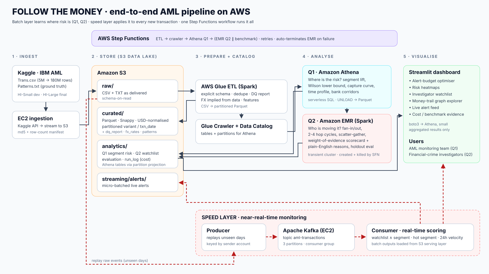

# Follow the Money  AML Risk Intelligence on AWS
**IS459 Big Data Architecture  Group G4**

An end-to-end big data pipeline on the IBM Transactions for Anti-Money-Laundering dataset (Kaggle,
[Altman et al., NeurIPS 2023](https://arxiv.org/abs/2306.16424)) that answers two business questions:

| | Business question | Who benefits | Output |
|---|---|---|---|
| **Q1** | Where should the AML monitoring team spend its limited review capacity? | Transaction-monitoring analysts, Head of AML Compliance | Segment risk (lift + Wilson lower bound), capture curve, **alert-budget optimiser**, heatmaps, bank corridors |
| **Q2** | Which accounts are moving the money, and why do we think so? | Financial-crime investigators | Graph motifs (fan-in/out, 2–4-hop cycles, scatter-gather, gather-scatter), **explainable weight-of-evidence scorecard**, top-1,000 watchlist with reasons, money-trail explorer |



## Repository map

| Path | What it is | Runs on |
|---|---|---|
| `ingestion/download_to_s3.sh` | Kaggle → S3 raw zone, streamed, with md5/row-count manifest | EC2 |
| `glue/etl_transactions.py` (+ `patterns_parser.py`) | Raw CSV → curated Parquet: explicit schema, DQ report, implied FX → USD, features | AWS Glue (Spark) |
| `athena/q1_*.sql`, `athena/ddl.sql`, `athena/run_athena.py` | Q1 analytics (UNLOAD to Parquet), table DDL with partition projection, CSV-vs-Parquet benchmark, per-query cost log | Athena via Glue Python shell |
| `emr/network_sql.py`, `emr/network_risk.py` | Q2 graph motifs + scorecard + holdout evaluation, written as portable SQL steps | Spark on a transient EMR cluster |
| `stepfunctions/aml_pipeline.asl.json` | Orchestration: ETL → crawler → Q1 → (Q2 ∥ benchmark); auto-terminates EMR on failure | Step Functions |
| `streaming/` | Kafka producer, consumer, scoring rules (`monitor_core.py`), EC2 Kafka setup | EC2 |
| `dashboard/app.py` | Streamlit dashboard (Athena mode or local mode) | EC2 / laptop |
| `infra/setup.sh`, `infra/teardown.sh` | One-shot deploy (idempotent) and full clean-up | CloudShell / EC2 |
| `local/` | Synthetic data generator in the exact Kaggle format + local runners (SQLite) | laptop |
| `tests/test_pipeline.py` | End-to-end local test suite (7 tests) | laptop |
| `docs/` | Design rationale with lecture references, rubric checklist, demo + video scripts | – |

## Quick start

### 0  Test locally (no AWS, ~1 minute)
```bash
pip install pandas numpy networkx           # plus streamlit plotly to view the dashboard
python -m unittest tests/test_pipeline.py -v
python local/make_synthetic_data.py --out data/raw --variant SYN-Small
python local/etl_local.py --trans data/raw/SYN-Small_Trans.csv --patterns data/raw/SYN-Small_Patterns.txt --variant SYN-Small
python local/run_local.py --train-until 2022-09-08
python local/replay_local.py --start 2022/09/08
DATA_MODE=local streamlit run dashboard/app.py      # shows SYNTHETIC data, clearly labelled
```

### 1  Deploy to AWS (Learner Lab, us-east-1)
```bash
cp infra/config.env.example infra/config.env      # set a globally unique BUCKET
aws emr create-default-roles                       # once, if EMR_DefaultRole does not exist
bash infra/setup.sh
```

### 2  Ingest (on a t3.medium EC2, instance profile LabInstanceProfile, 40 GB disk)
```bash
export BUCKET=... KAGGLE_USERNAME=... KAGGLE_KEY=...
bash ingestion/download_to_s3.sh HI-Small       # dev
bash ingestion/download_to_s3.sh HI-Large       # final demo
```
> Tip: before touching the real data, upload `data/raw/SYN-Small_*` to `raw/.../variant=SYN-Small/` and run the
> pipeline on it - a 2-minute, cents-cheap smoke test of every AWS stage.

### 3  Run the whole pipeline (one click)
```bash
aws stepfunctions start-execution --state-machine-arn <arn printed by setup.sh> \
  --input '{"variant":"HI-Small","core_nodes":2,"run_benchmark":true,"train_until":"none"}'
```
For the live demo on unseen data, run once with `"train_until"` set to a date about 70 % into the variant's range
(check with `SELECT MIN(txn_date), MAX(txn_date) FROM aml.transactions WHERE variant='HI-Small'`), so the batch
layer only learns from earlier days; then replay the later days through Kafka with `producer.py --start`.

### 4  Live monitor + dashboard (on the Kafka EC2)
```bash
bash streaming/setup_kafka_ec2.sh
python3 streaming/consumer.py --bucket $BUCKET --variant HI-Small &
python3 streaming/producer.py --source s3://$BUCKET/raw/transactions/variant=HI-Small/HI-Small_Trans.csv \
        --start 2022/09/08 --max-events 200000 --speed 3600
DATA_MODE=athena BUCKET=$BUCKET streamlit run dashboard/app.py --server.port 8501
```

### 5  After Week 13
```bash
bash infra/teardown.sh        # deletes bucket, Glue, Step Functions, EMR; then terminate EC2 instances
```

## Design highlights
* **Portable SQL, tested locally.** Q1 SQL runs unchanged in Athena and SQLite; Q2 SQL runs unchanged in Spark SQL and SQLite, so the exact logic deployed was tested on a laptop first.
* **No label leakage.** Scorecard weights are learned on half the accounts (by account-id digit) and precision is reported on the other half; the streaming demo replays days the batch layer never saw.
* **Statistically honest ranking.** Q1 ranks segments by the 95 % Wilson lower bound, so tiny lucky segments cannot top the list.
* **Explainable by design.** Every watchlist account carries plain-English reasons; no black-box model.
* **Cost-aware.** Columnar + partitioned storage, partition projection, transient EMR, lifecycle rules, per-query cost log, teardown script.

See `docs/design.md` for every decision with its lecture reference and `docs/rubric_checklist.md` for how each
grading criterion is met.
